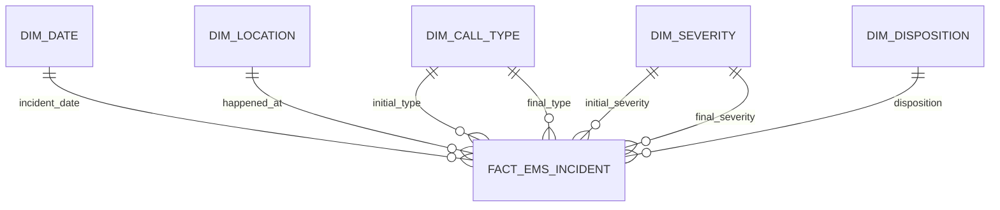

# Milestone 3 — EMS warehouse model

## Purpose

This model organizes the curated EMS data so users can count incidents and compare response times by date, place, call type, severity, and disposition. It is a dimensional **star schema** for the later OLAP work and dashboard.

## Grain

`fact_ems_incident` has **one row per source EMS incident** (`incident_id`). Durations are stored in seconds, as in the source. A row remains one incident even when it has missing values or quality flags.

## Model layout

ṭ
The date, call type, and severity dimensions are reused in separate roles. The fact also retains the original event timestamps, source validity indicators, operational indicators, and quality flags. This preserves event-level detail without adding seven role-specific date joins to the first dashboard query.

## Tables

| Table | Contents |
|---|---|
| `dim_date` | Calendar day, year, quarter, month, weekday and weekend labels. Key `0` is the unknown/not supplied date. |
| `dim_location` | Borough, dispatch area, ZIP code, and district identifiers together as a usable location slice. Key `0` is unknown. |
| `dim_call_type` | A distinct source call-type code and its supplied description, if available. Initial and final roles point to this same table. |
| `dim_severity` | Source severity code as text. The available source does not define the code meanings, so no rank or clinical interpretation is assigned. |
| `dim_disposition` | Source disposition code and supplied description when available. Unmapped codes are retained. |
| `fact_ems_incident` | One incident, dimension keys, exact source timestamps, duration measures, flags and indicators. `incident_id` is retained as the source identifier and unique business key. |

## Measures and dashboard definitions

- **Incident count:** count of fact rows (or distinct `incident_id`).
- **Average incident response seconds:** average of `incident_response_seconds` only when `valid_incident_response = 'Y'` and the measure is present.
- **Average dispatch response seconds:** average of `dispatch_response_seconds` only when `valid_dispatch_response = 'Y'` and the measure is present.
- **Average travel seconds:** average of non-null travel duration.
- Also report the valid sample count alongside every response-time average. Do not treat source-invalid zero values as real response times; the curated copy already made those invalid dispatch/incident measures null.
- IQR outlier and timestamp-order fields are quality flags, not exclusion rules. Keep flagged incidents in totals unless a report clearly says it applied another filter.

## Source-to-model mapping

- `incident_id` becomes the fact's business key; warehouse `incident_key` is a generated integer key.
- Incident date maps to `dim_date`; all seven exact event times remain on the fact as nullable timestamps.
- Borough, dispatch area, ZIP and five district fields map to `dim_location`.
- Initial/final call type and initial/final severity map to their respective dimension roles.
- Disposition maps to `dim_disposition`.
- The three durations, two validity indicators, four incident indicators, and four curation flags remain on the fact. No source category is silently discarded or rewritten.
- Missing dimension values use key `0`; blank source code/text fields are retained as null on the fact or dimension. Do not turn a missing source value into a real category such as `UNKNOWN` unless the source itself supplied that text.

## Build notes

The PostgreSQL implementation uses the assignment's recommended batch database in Docker. `etl/load_postgres_warehouse.py` first loads a staging table, then loads dimensions and the incident fact. It loads January 2024 through May 2026 as the initial batch, then loads June 2026 separately as an incremental batch. The `etl_batch_audit` table records both runs. Exact event timestamps stay on the incident fact; date and time dimensions support calendar and hour analysis.

The dimensions are initially Type 1 (current value) because this source is an incident snapshot and has no documented history of location or code-description changes. If later source extracts demonstrate historical changes, use Type 2 versions with effective dates.

The detailed hourly aggregate is kept by location key in `fact_borough_hourly_ems_performance`; the view `v_borough_hourly_ems_performance` rolls it up to borough for dashboards. During bulk loads, PostgreSQL per-row foreign-key triggers are bypassed only within the loading transaction. The loader checks every new row for orphan keys before commit, and database constraints remain active for later use.

Load reconciliation is saved in `reports/postgres_warehouse_summary.json`. Credentials are held in the ignored local `.env` file; do not share that file.
