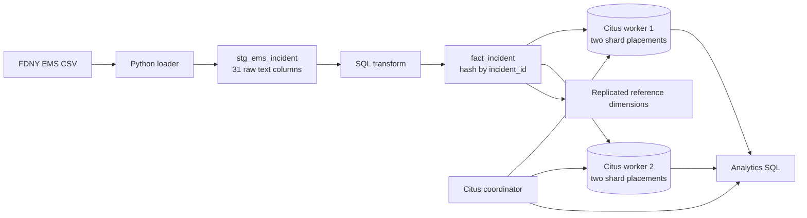
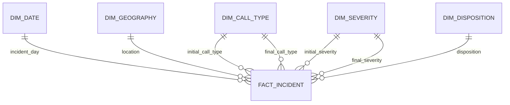

# Distributed Warehouse Architecture

## Runtime topology

The local Compose topology runs Citus 14.2.0 with one coordinator and two worker containers. `fact_incident` is hash-distributed by `incident_id` into four shards, with one replica of each shard. The small dimension tables are Citus reference tables, so the coordinator can join them with the distributed fact table. The integration check confirms two active workers and two shard placements on each.

The cluster is a teaching setup for distributed table placement and query correctness. It uses the original 1,310 incidents; no scale or performance conclusions are drawn from this dataset size.

## Data flow

1. The loader checks that the CSV header matches all 31 expected source columns.
2. `COPY` loads the original CSV values as text into `stg_ems_incident`.
3. SQL converts durations and timestamps for analytics, creates missing dimension values, and upserts one `fact_incident` row per `incident_id`.
4. `etl_batch` records the source filename and the staged/fact row counts.
5. SQL reports incident volume and valid response-time averages by borough, initial call type, and month.

The staging table has a primary key on source `incident_id`; repeated source IDs fail during staging. Fact upserts use the same ID. Re-running the supplied full snapshot leaves 1,310 distinct facts.

## Star schema

`fact_incident` has a grain of one source incident. Role-specific foreign keys preserve initial and final call types and severity levels separately. The geography dimension combines borough, dispatch area, ZIP code, precinct, and district fields. `UNKNOWN` is used for a missing geography attribute so the incident remains available to counts.

## Quality and metric rules

- Staging preserves source values as text without rewriting the CSV.
- Dispatch and incident-response measures are usable only when the matching source flag is `Y`, the value is present, and it is nonnegative.
- Travel time has no dedicated source validity flag. Its separate project-derived usable flag means the value is present and nonnegative.
- Incident volume counts every fact row. Each response average includes only usable values and has a matching valid-value count.
- The ordered timestamp check flags a row when two consecutive present timestamps run backwards. Missing intermediate timestamps do not by themselves trigger the flag.
- Quality issues are retained and documented, not silently corrected or dropped.
