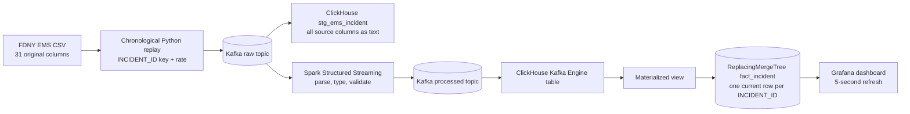

# Architecture

## Local flow

The source dataset is a historical snapshot, so the producer replays it to demonstrate a stream. Its event times are retained as supplied and are not rewritten to match wall clock. Spark's `ingested_at` is a separate timestamp indicating processing time.

## Services and scope

`docker-compose.yml` starts one single-node Kafka KRaft broker, one Spark Structured Streaming process (`local[2]`), one ClickHouse server, and Grafana. Kafka and ClickHouse remain on the private Compose network; Grafana is published on loopback only at port 3002 by default. This is a local demonstration topology, not a resilient multi-node streaming cluster.

Kafka has one partition per topic for deterministic local replay. The Spark checkpoint preserves progress across restarts. The raw topic stores the original field names and values; a ClickHouse Kafka Engine table and materialized view persist all 31 source columns to `stg_ems_incident` as text. Spark independently reads that raw topic to create a smaller analytics record. ClickHouse consumes the processed topic with its own Kafka Engine table and materialized view. The fact table uses yearly partitions to keep a single multi-year replay batch within ClickHouse's default partition-per-insert guardrail.

## Idempotence and query behavior

Each replayed source row is sent with `INCIDENT_ID` as its Kafka message key. The raw staging table uses `ReplacingMergeTree(raw_ingested_at)` and the fact table uses `ReplacingMergeTree(ingested_at)`, both ordered by the incident ID. Since replacement merges run asynchronously, live dashboard queries use `FINAL` at query time. The 10-second check sends an existing source ID and confirms a single current row through Grafana's provisioned ClickHouse query API. This validates local event visibility, not a universal latency guarantee.

## Analytics and quality rules

Incident volume counts every current incident. Dispatch and incident-response averages include only nonnegative measurements whose original FDNY validity flag is `Y`; each dashboard average includes a matching valid count. Travel is retained independently and is usable only when present and nonnegative because the source has no corresponding travel validity flag. `timestamp_order_ok` checks the source timeline in order; invalid ordering is surfaced in a dashboard data-quality count without deleting an incident.

Date, borough, initial/final call type, initial/final severity, and disposition are carried as typed dimensions/attributes in the fact record. This realtime warehouse is physically optimized as a current-state fact table rather than reproducing the Citus star schema.
